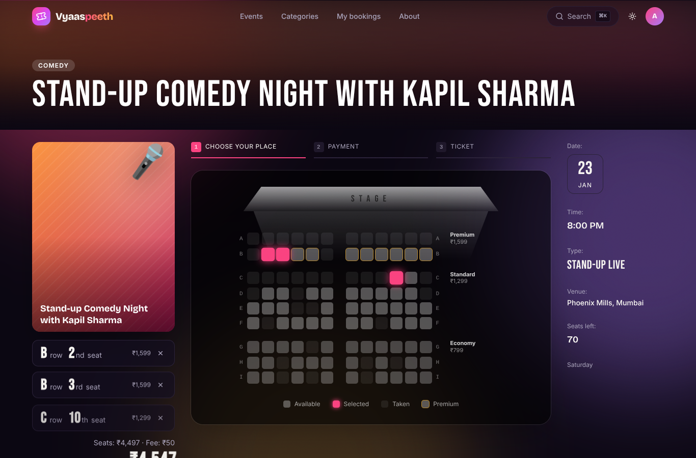
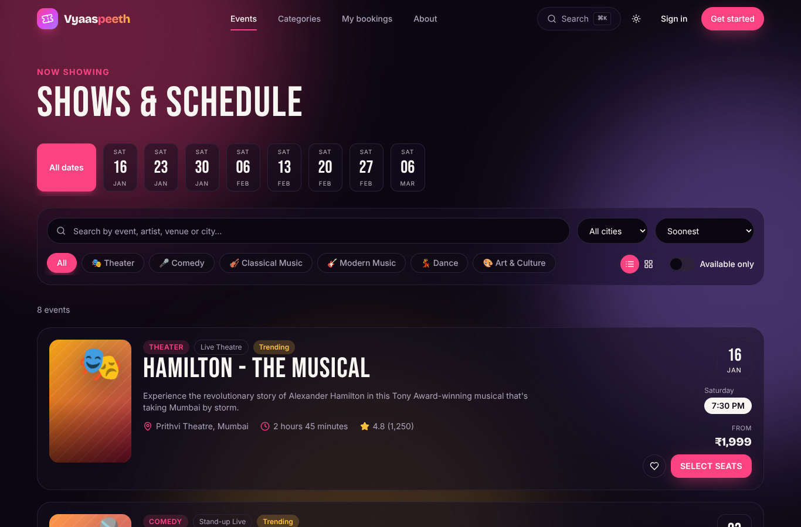
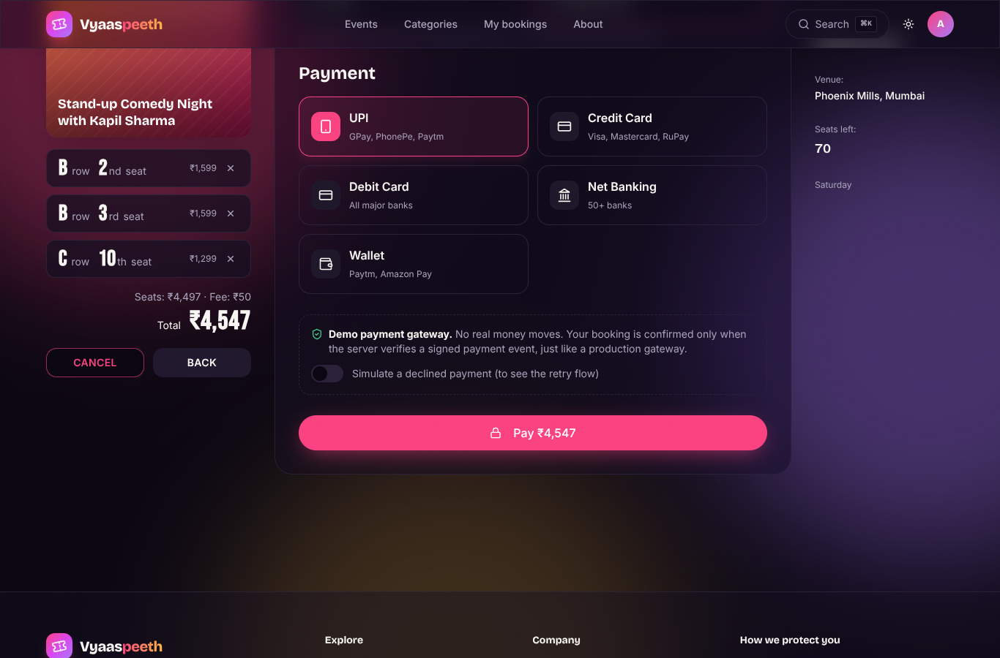
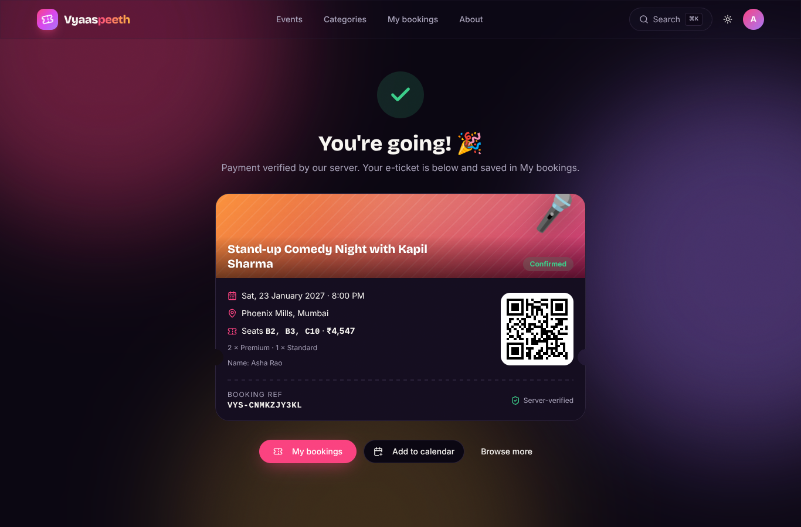
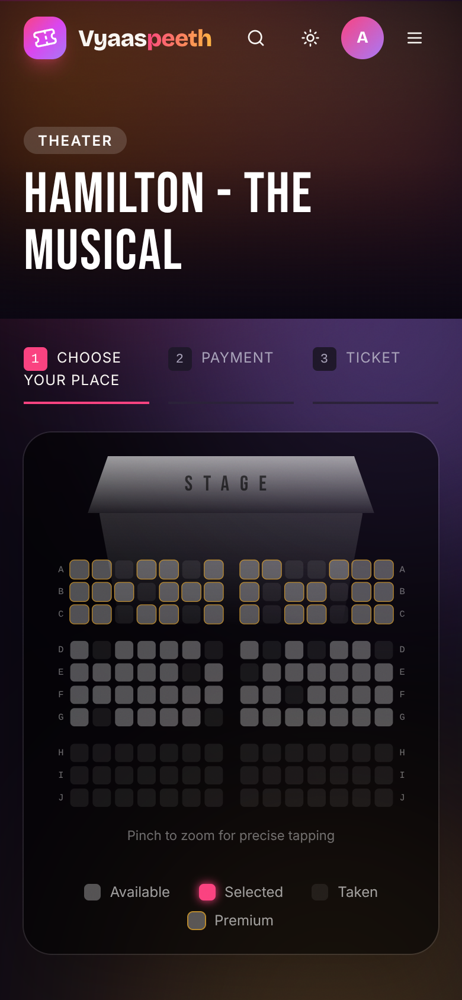
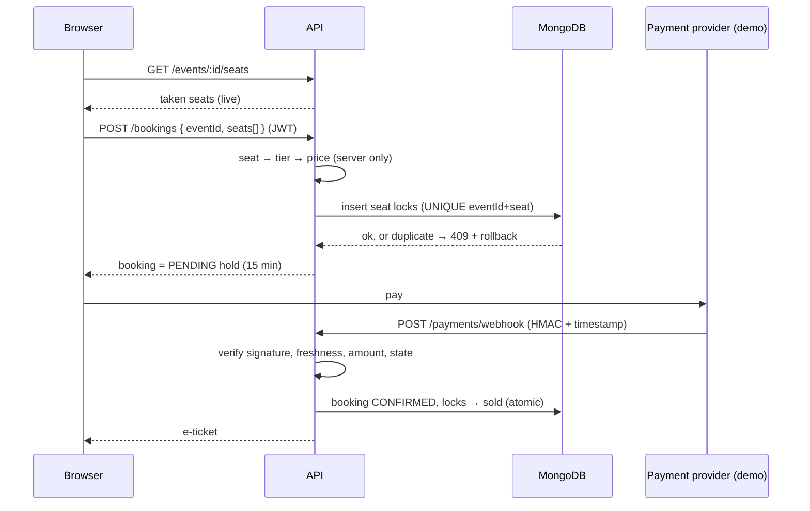

<div align="center">

# 🎟️ Vyaaspeeth
### Event booking with a live cinema-style seat map and a security-first backend

Pick exact seats on an interactive hall map, pay through a signed-webhook payment flow, and get a QR e-ticket. Built to show **full-stack product polish** and **application-security engineering** in one project.

     



</div>

## Try it in 60 seconds (no database needed)

```bash
git clone https://github.com/sid1929/vyaaspeeth.git && cd vyaaspeeth
npm run setup      # installs backend + frontend
npm run dev        # API (in-memory store) + web app together
```
Open **http://localhost:3000** → *Get started* → pick a show → **Select seats** → choose seats → **Pay** (demo gateway, no real money) → your QR ticket appears.

Want real persistence? `cp backend/.env.example backend/.env`, set `MONGODB_URI`, then `npm run dev:mongo`. Something not working? Run `npm run doctor`, or see [Troubleshooting](#troubleshooting).

## Screenshots

| Shows & schedule | Choose your place |
|---|---|
|  |  |
| **Payment** | **E-ticket with QR** |
|  |  |

<p align="center"></p>

## What it does

- **Cinema-style schedule**: date strip, list/grid views, filters, saved events, ⌘K command palette.
- **Live seat map**: stage, rows grouped by price tier (Premium / Standard / Economy), aisle gaps, real-time availability refresh, keyboard-accessible seats, fits phone screens.
- **3-step checkout**: *Choose your place → Payment → Ticket*, with a 15-minute seat hold and countdown.
- **QR e-ticket** with seat numbers, calendar (.ics) export, cancel with refund rules (24-hour window).
- **Accounts**: sign up / sign in / sign out, "keep me signed in", protected pages that return you where you were headed.
- **Polish**: dark/light themes, animated aurora background, 3D-tilt cards, scroll reveals, skeleton loaders, reduced-motion support, clear error banners when the API is unreachable.

## Why the backend is interesting

| Problem | How it is solved | Proof |
|---|---|---|
| **Double booking** | Every held/sold seat is a row with a **UNIQUE index on (event, seat)**; two simultaneous requests for one seat produce exactly one booking, and partial locks are rolled back | concurrency test + real-MongoDB integration test |
| **Price tampering** | Client sends only seat ids. Seat → row → tier → price, fee and total are computed server-side; any extra field is rejected | tamper tests |
| **Payment spoofing / replay** | Booking is a *hold*; only an HMAC-signed, fresh, amount-matching event confirms it, atomically and idempotently | signature, timestamp, amount, replay tests |
| **IDOR** | Ownership is part of every booking query; someone else's reference looks like a missing one | cross-user tests |
| **Credential attacks** | bcrypt (12 rounds), identical errors + timing equalisation, per-account+IP rate limiting, pinned-algorithm JWTs, server-side logout | auth tests |
| **Abandoned carts** | Holds expire and release seats automatically | expiry tests |
| **Injection / malformed input** | Strict Zod schemas on every route (unknown keys rejected), body limits, Helmet, CORS allow-list, CSP on the web app | validation tests |



## Tech stack

Next.js 15 (App Router) · React 19 · TypeScript · Tailwind CSS · shadcn/ui · Node 20 · Express 5 · MongoDB + Mongoose · Zod · JWT · bcrypt · Helmet · express-rate-limit. Fonts are bundled locally (no external font requests).

## Project structure

```text
vyaaspeeth/
├── frontend/            Next.js app (pages, seat map, checkout, API client)
│   └── lib/catalog.json   display copy of the catalog (CI checks it matches the backend)
├── backend/
│   ├── data/events.json   SOURCE OF TRUTH: events, tiers, prices, hall layouts
│   ├── src/               app, routes, schemas, seat logic, middleware, models
│   ├── server.js          production entry (MongoDB)
│   ├── server.memory.js   zero-setup entry (in-memory store)
│   ├── scripts/doctor.js  diagnoses setup problems
│   └── test/              API security tests + MongoDB integration test
├── scripts/e2e.js         real-browser end-to-end test (also regenerates screenshots)
└── .github/workflows/     CI: tests (with a MongoDB service), typecheck, build, audit
```

## Tests

```bash
npm test                 # 36 API tests (auth, IDOR, tampering, seat locking, payments, rate limits, CORS)
npm run typecheck        # strict TypeScript
npm run e2e              # drives the real UI in a browser (needs: npm i -D puppeteer, and `npm run dev` running)
```
- A **MongoDB integration test** runs when `MONGODB_TEST_URI` is set (CI does this with a Mongo service). It proves the unique seat index and the booking → payment → cancel lifecycle on the real database.
- `npm run e2e` checks: sign up, choose seats on the map, pay, ticket, double-booking rejected, price tampering rejected, other users cannot read your booking, sign out / sign in / wrong password, redirect back to the wanted page, phone layout.

## Troubleshooting

| Symptom | Cause and fix |
|---|---|
| Red banner "Can't reach the API" | The backend isn't running. Use `npm run dev` from the repo root (starts both). If you run them separately, start the backend first. |
| Sign-in or sign-up does nothing / "Cannot reach the API" | Wrong `NEXT_PUBLIC_API_URL` (must end in `/api`; **restart `npm run dev` after changing it**) or the API is down. |
| Error "Origin not allowed" | In production set `CORS_ORIGINS` to your exact frontend origin. In development any `localhost` port is already allowed. |
| Logged out right after signing in | Production needs a stable `JWT_SECRET` (32+ chars). In development one is generated into `backend/.dev-secrets.json` so sessions survive restarts. |
| Pay button says "Not found" | Demo payments are **off by default in production**. Set `ENABLE_MOCK_PAYMENTS=true` for a demo deployment, or add a real provider. |
| "Some of those seats were just taken" | Someone else grabbed them first. The map refreshes; pick other seats. That is the double-booking protection working. |
| Backend exits at start | Run `npm run doctor` (checks Node version, `MONGODB_URI`, Atlas network access, secrets, CORS). |
| Deployed site can't reach the API | `NEXT_PUBLIC_API_URL` must be set **at build time** to your `https://…/api` URL; the CSP `connect-src` is generated from it. |

## Configuration

| Variable | Where | Notes |
|---|---|---|
| `MONGODB_URI` | backend | required for `npm run dev:mongo` / production |
| `JWT_SECRET`, `PAYMENT_WEBHOOK_SECRET` | backend | 32+ chars, **required in production** (auto-generated for dev) |
| `CORS_ORIGINS` | backend | comma-separated exact origins |
| `TRUST_PROXY` | backend | `1` behind one reverse proxy (Render, etc.) |
| `ENABLE_MOCK_PAYMENTS` | backend | demo gateway; default on in dev, off in production |
| `JWT_EXPIRES_IN` | backend | default `8h` |
| `NEXT_PUBLIC_API_URL` | frontend | default `http://localhost:5000/api` |

Generate secrets: `node -e "console.log(require('crypto').randomBytes(48).toString('hex'))"`. Never commit `.env`.

## API

| Method | Endpoint | Auth | Purpose |
|---|---|---|---|
| GET | `/api/health` | – | status |
| GET | `/api/events`, `/api/events/:id` | – | catalog, tiers, hall layout |
| GET | `/api/events/:id/seats` | – | live taken seats |
| POST | `/api/signup`, `/api/login` | – | returns `{ token, user }` |
| GET | `/api/me` · POST `/api/logout` | JWT | session; logout invalidates all tokens |
| POST | `/api/bookings` | JWT | hold seats (server-priced) |
| GET | `/api/bookings`, `/api/bookings/:ref` | JWT | own bookings only |
| POST | `/api/bookings/:ref/cancel` | JWT | cancel / refund rules |
| POST | `/api/payments/mock-checkout` | JWT | demo gateway (signs a real webhook event) |
| POST | `/api/payments/webhook` | HMAC | provider events |
| POST | `/api/messages` | – (rate limited) | contact / feedback |

## Honest limitations (what I would do next)

- Payments use a **demo gateway** that signs events exactly like a provider would; integrate Stripe/Razorpay and verify their signatures for real money.
- Add MFA and password reset; move the token to an httpOnly cookie with CSRF protection, or adopt a nonce-based CSP (the current CSP still allows inline scripts that Next.js needs).
- Rate limits are in-memory per instance (use Redis when scaling out); no seat-level pricing rules or per-user purchase limits yet.
- Secret scanning in CI, centralised logging/alerting, and an independent penetration test.
- The seat map is available/taken only; wheelchair-accessible seating and screen-reader seat-block summaries would be good additions.

## Deployment

Deploy `frontend/` (Vercel) and `backend/` (Render/Fly/etc.) separately. Backend: `NODE_ENV=production`, `MONGODB_URI`, `JWT_SECRET`, `PAYMENT_WEBHOOK_SECRET`, `CORS_ORIGINS=https://your-frontend`, `TRUST_PROXY=1`. Frontend: `NEXT_PUBLIC_API_URL=https://your-api/api`. For a demo deployment without a payment provider, also set `ENABLE_MOCK_PAYMENTS=true`.

## Responsible use

Use synthetic data. Only test systems you own or are authorised to assess.

## License

MIT
